<div dir="rtl" lang="he">

# אור במנהרה: שלב הלימוד

השחקן מתעורר בתא במנהרה. הוא צריך לצאת, לעבור את השומר ואת מצלמות האבטחה בלי להיראות, לקחת בקבוק מים מהמחסן ולהחזיר אותו למזרן. הזיכרונות והתפילה נותנים תקווה, והתקווה נותנת לגוף כוח: מהירות, ראייה בחושך ושמיעה.

מסמך העיצוב: [Light-in-the-Tunnel](https://github.com/Game-development-Ariel/Light-in-the-Tunnel)

## קישורים

* המשחק באיץ' (אפשר לשחק בדפדפן): [game-dev-ariel.itch.io/ex4-light-in-the-tunnel](https://game-dev-ariel.itch.io/ex4-light-in-the-tunnel)
* דיווח על שימוש בבינה מלאכותית: [AI_REPORT.md](AI_REPORT.md)

## איך מריצים

1. אחרי `git clone` מריצים `git lfs pull`, כי התמונות והצלילים שמורים ב-Git LFS.
2. ב-Unity Hub פותחים את התיקייה של המאגר, בגרסה 6000.3.25f1.
3. פותחים את הסצנה `Assets/Scenes/Tutorial` ולוחצים Play.

הסצנה נבנית מקוד, בכלים שב-`Assets/Scripts/Editor`. אחרי שינוי בכלים מריצים `Tools > Rebuild Scene`. בנייה לדפדפן: `Tools > Build WebGL`. הבנייה יוצאת לתיקייה `../ex4-webgl-builds/ex4-light-in-the-tunnel`, ליד תיקיית הפרויקט ולא בתוכה, כדי שלא תיכנס לגיט.

## איך משחקים

* תנועה: WASD או חצים, אחרי שהעיניים נפתחות בפתיחה. בטלפון יש ג'ויסטיק על המסך. M מציג ומסתיר את המפה.
* דוחפים דלת, ארגז או שק חול כשהולכים לתוכם.
* בפינה המוארת בקיר המסדרון עומדים שלוש שניות בלי לזוז, כדי לומר פסוק.
* **ניצחון**: מביאים את הבקבוק למזרן.
* **הפסד**: כל היתפסות (בפנס של השומר או באור של מצלמה) מורידה 20 תקווה ומחזירה לתא. בלי תקווה היום נגמר.

## פיסיקה

המשחק הזה לבדו משתמש בכל התכונות שנלמדו:

| תכונה | איפה | קובץ |
|---|---|---|
| CharacterController | תנועת השחקן. נעצר בקירות ומחליק לאורכם | [PlayerMovement.cs](Assets/Scripts/Player/PlayerMovement.cs) |
| Rigidbody | ארגזים, שקי חול ודלת התא | [TutorialMapBuilder.cs](Assets/Scripts/Editor/TutorialMapBuilder.cs) (הפונקציה `BuildLooseObjects`) |
| AddForce | השחקן דוחף בכוח שמופעל בנקודת המגע (`AddForceAtPosition`), ולכן ארגז גם מסתובב. בכל פריים הדחיפה היא מתקף של כוח כפול זמן הפריים, כך שהיא זהה בכל קצב פריימים | [PlayerPush.cs](Assets/Scripts/Player/PlayerPush.cs) |
| Raycast | המצלמות והשומר: קרניים שנעצרות בקיר קובעות גם מה הם רואים וגם איך נראה קונוס האור. ארגז שנדחף עוצר אותן, אז אפשר להסתתר מאחוריו | [VisionSensor.cs](Assets/Scripts/Security/VisionSensor.cs) |
| Collision | ארגז או שק חול שנדחף בודק במה פגע ובאיזו מהירות. מכה בקיר עושה רעש, וככל שהיא מהירה יותר הרעש חזק יותר. לכל סוג יש צלילים משלו, בנכס [ImpactSounds](Assets/Scripts/Level/ImpactSounds.cs) | [ImpactNoise.cs](Assets/Scripts/Level/ImpactNoise.cs) |
| מחבר (רשות) | דלת התא תלויה על HingeJoint ונפתחת כשנשענים עליה | [TutorialMapBuilder.cs](Assets/Scripts/Editor/TutorialMapBuilder.cs) (הפונקציה `CreateHingedDoor`) |

המנהרה מצוירת בדו-ממד, אבל הפיסיקה תלת-ממדית: לכל קיר שנוגע ברצפה יש BoxCollider, והכול זז על מישור X-Y. ההסבר בהחלטה 2 למטה.

## מבנה התיקיות

<div dir="ltr">

```
Assets/
├── Scripts/        LightInTheTunnel.asmdef (the game code)
│   ├── Player/     PlayerMovement, PlayerPush, PlayerRespawn, Hope, HopeSenses, HopeThoughts, HopeEffects, BottleCarrier
│   ├── Security/   VisionSensor, VisionStats, VisionConeMesh, CameraSweep, CameraIndicators, GuardPatrol, HeardSteps
│   ├── Items/      WaterBottle, BottleSpawner, MattressGoal
│   ├── Level/      HintZone, MemoryZone, QuietPlace, ImpactNoise, ImpactSounds, NoiseWarning, IPushable
│   ├── Game/       TunnelRound, RoundStats, LevelFreeze, TunnelLevelSettings
│   ├── Events/     GameEvent, TextEvent   (ScriptableObject)
│   ├── UI/         HUD: ScreenVignette, HopeBar, WaterIndicator, ObjectiveThought, CaptureBlackout
│   │               HintToast, MemoryCaption, TitleCard, EndScreen, ObjectiveMarker, Minimap, MinimapToggle,
│   │               MobileJoystick, ButtonFeel, ScreenFader, UiFactory, UiAnim, UiTheme
│   ├── Effects/    MoodVolume, Tension, ScreenShake, LightFlicker, DustMotes, WalkBounce, Bob
│   ├── Audio/      Footsteps, MusicPlayer, Sfx
│   ├── Camera/     CameraFollow, OrientationCameraSize, ScreenSizeWatcher
│   └── Editor/     the tools that build the scene (LightInTheTunnel.Editor.asmdef):
│                   ProjectBuilder (Rebuild Scene, Build WebGL), TunnelAssets, SetupTools, SceneParts, PlaceholderSprites,
│                   1 map:  TutorialMapBuilder, TutorialLayout, WallColliderBuilder, LooseObjectBuilder, WatcherBuilder
│                   2 game: TunnelLevelSetup
│                   3 feel: GameFeelSetup, LightSetup, MoodSetup, SoundSetup, TeachingSetup, HudSetup
├── Data/           Events/ (PlayerCaught, BottlePicked, BottleDropped, BottleDelivered, OpeningFinished,
│                   LevelWon, LevelLost, HintRequested, MemoryFound),
│                   TutorialLevelSettings, HopeEffects, SecurityCameraVision, RoomCameraVision, GuardVision,
│                   CrateSounds, SandbagSounds
├── Tests/
│   ├── Common/     TestUtils, TestData, EventSpy   (LightInTheTunnel.Tests.Common.asmdef)
│   ├── EditMode/   Events, Player, Game, Level, Security, UI, Data, Scene, Architecture, EditorTools
│   │               (LightInTheTunnel.Tests.EditMode.asmdef)
│   └── PlayMode/   Scene, Player, Game, Items, Level, Security, UI, Effects, Audio, Camera, Helpers
│                   (LightInTheTunnel.Tests.PlayMode.asmdef)
├── Prefabs/  Scenes/  Sprites/  Tiles/  Resources/  Settings/
```

</div>

`Game` מחזיקה את החוקים (מתי מנצחים ומפסידים, מתי השחקן יכול לזוז), ו-`UI` מציגה. קוד המשחק לא מכיר את קוד הממשק: הממשק מאזין לאירועים של המשחק, ולא להפך. הממשק גם לא משנה את המשחק: הוא לא מכבה את השחקן ולא עוצר את השלב, את זה עושה LevelFreeze.

## יחסי המחלקות

יש שני סוגי אירועים:

* **אירוע כנכס** ([GameEvent](Assets/Scripts/Events/GameEvent.cs), [TextEvent](Assets/Scripts/Events/TextEvent.cs)): ScriptableObject שרכיב אחד מרים ואחרים מאזינים לו. השולח והמאזינים מחזיקים רק את הנכס ולא מכירים זה את זה.
* **אירוע רגיל של C#** (`event Action`): כשהמאזין ממילא מחזיק הפניה לשולח, כמו HopeBar שמציג את התקווה, או Minimap שמאזין ל-ScreenSizeWatcher.

כל הרשמה נעשית ב-`OnEnable` ומבוטלת ב-`OnDisable`.

בתרשים: מלבן הוא מחלקה, צורה מעוגלת היא אירוע כנכס (חץ עבה), גליל הוא נכס נתונים ב-`Assets/Data`, חץ מקווקו הוא אירוע רגיל של C#, וחץ רגיל הוא קריאה ישירה.

```mermaid
flowchart LR
    CameraSweep -- turns the object of --> VisionSensor
    GuardPatrol -- moves the object of --> VisionSensor
    VisionSensor -- reads --> VisionStats[(VisionStats)]
    VisionConeMesh -- DistanceToWall --> VisionSensor
    CameraIndicators -- IsAlarmed --> VisionSensor
    Tension -- finds all --> VisionSensor
    HeardSteps -- IsWalking --> GuardPatrol
    HeardSteps -- HearingRange --> HopeSenses
    VisionSensor ==> PlayerCaught([PlayerCaught])

    PlayerCaught ==> TunnelRound
    PlayerCaught ==> RoundStats
    PlayerCaught ==> LevelFreeze
    PlayerCaught ==> BottleCarrier
    PlayerCaught ==> PlayerRespawn
    PlayerCaught ==> CaptureBlackout
    PlayerCaught ==> MoodVolume
    PlayerCaught ==> ScreenShake

    TitleCard ==> OpeningFinished([OpeningFinished])
    OpeningFinished ==> LevelFreeze
    OpeningFinished ==> RoundStats
    LevelFreeze -- enabled --> PlayerMovement
    LevelFreeze -- enabled --> VisionSensor
    LevelFreeze -- reads --> LevelSettings[(TunnelLevelSettings)]
    CaptureBlackout -- reads --> LevelSettings
    ObjectiveThought -- reads --> LevelSettings
    EndScreen -- reads --> LevelSettings
    Hope -- reads --> LevelSettings
    TitleCard -- Show --> HintToast

    PlayerPush -- AddForceAtPosition --> Pushable[Crate / Sandbag / Cell Door: Rigidbody]
    PlayerPush -- PushStarted --> IPushable{{IPushable}}
    PlayerPush -- WalkingSpeed --> PlayerMovement
    IPushable --- ImpactNoise
    ImpactNoise -- reads --> ImpactSounds[(ImpactSounds)]
    ImpactNoise -- WallHit --> NoiseWarning
    WaterBottle -- PickUp --> BottleCarrier
    MattressGoal -- HasBottle, Deliver --> BottleCarrier
    BottleCarrier ==> BottlePicked([BottlePicked])
    BottlePicked ==> WaterIndicator
    BottlePicked ==> ObjectiveThought
    BottlePicked ==> ObjectiveMarker
    BottleCarrier ==> BottleDropped([BottleDropped])
    BottleDropped ==> BottleSpawner
    BottleDropped ==> WaterIndicator
    BottleDropped ==> ObjectiveThought
    BottleDropped ==> ObjectiveMarker
    BottleDropped ==> CaptureBlackout
    ObjectiveMarker -- Bottle --> BottleSpawner
    MattressGoal ==> BottleDelivered([BottleDelivered]) ==> TunnelRound

    TunnelRound -- Lose --> Hope
    TunnelRound -- reads --> LevelSettings
    MemoryZone -- Add --> Hope
    QuietPlace -- Add --> Hope
    QuietPlace -- IsWalking --> PlayerMovement
    Hope -. Changed .-> HopeBar
    Hope -. Changed .-> HopeSenses
    Hope -. Changed .-> HopeThoughts
    HopeSenses -- reads --> HopeEffects[(HopeEffects)]
    HopeThoughts -- reads --> HopeEffects
    HopeSenses -- SpeedFactor --> PlayerMovement
    Footsteps -- IsWalking --> PlayerMovement
    WalkBounce -- IsWalking --> PlayerMovement

    TunnelRound ==> LevelWon([LevelWon])
    TunnelRound ==> LevelLost([LevelLost])
    LevelWon ==> LevelFreeze
    LevelLost ==> LevelFreeze
    LevelWon ==> RoundStats
    LevelLost ==> RoundStats
    LevelWon ==> EndScreen
    LevelLost ==> EndScreen
    EndScreen -- reads results --> RoundStats
    EndScreen -- reads results --> Hope
    MoodVolume -- reads --> Hope
    MoodVolume -- Danger --> Tension

    HintZone ==> HintRequested([HintRequested]) ==> HintToast
    NoiseWarning ==> HintRequested
    HopeThoughts ==> HintRequested
    ObjectiveThought ==> HintRequested
    CaptureBlackout ==> HintRequested
    MemoryZone ==> MemoryFound([MemoryFound]) ==> MemoryCaption
    QuietPlace ==> MemoryFound

    ScreenSizeWatcher -. Changed .-> OrientationCameraSize
    ScreenSizeWatcher -. Changed .-> Minimap
    MinimapToggle -- SetVisible --> Minimap
```

<div dir="ltr">



</div>

| אירוע | מי שולח | מי מקבל |
|---|---|---|
| PlayerCaught | VisionSensor (של כל מצלמה ושל השומר) | TunnelRound (מוריד תקווה), RoundStats (סופר), LevelFreeze (מקפיא את השחקן לרגע), BottleCarrier (מפיל את הבקבוק), PlayerRespawn (מחזיר לתא), CaptureBlackout (מסך שחור), MoodVolume, ScreenShake |
| OpeningFinished | TitleCard | LevelFreeze (השחקן יכול לזוז), RoundStats (השעון מתחיל) |
| BottlePicked | BottleCarrier | WaterIndicator, ObjectiveThought, ObjectiveMarker |
| BottleDropped | BottleCarrier (רק כשנתפסים עם הבקבוק) | BottleSpawner (בקבוק חדש), WaterIndicator, ObjectiveThought, ObjectiveMarker, CaptureBlackout |
| BottleDelivered | MattressGoal | TunnelRound |
| LevelWon, LevelLost | TunnelRound | LevelFreeze (עוצר את השחקן ואת הצופים מיד, ואת השלב אחרי ההחשכה), RoundStats (השעון נעצר), EndScreen |
| HintRequested | HintZone, NoiseWarning, HopeThoughts, ObjectiveThought, CaptureBlackout | HintToast |
| MemoryFound | MemoryZone, QuietPlace | MemoryCaption |
| Hope.Changed (C#) | Hope | HopeBar, HopeSenses, HopeThoughts |
| ScreenSizeWatcher.Changed (C#) | ScreenSizeWatcher | OrientationCameraSize, Minimap |

המצלמה בנויה מרכיבים קטנים על אותו אובייקט: CameraSweep מסובב, VisionSensor רואה, VisionConeMesh מצייר את מה שהחיישן רואה, ו-CameraIndicators מוסיף נורה וזמזום. השומר בנוי מאותם VisionSensor ו-VisionConeMesh, ורק מה שמזיז אותו שונה: GuardPatrol במקום CameraSweep.

התקווה משנה את הגוף דרך [HopeSenses](Assets/Scripts/Player/HopeSenses.cs): ככל שיש יותר תקווה הגיבור הולך מהר יותר, רואה רחוק יותר בחושך (רדיוס האור סביבו והבהירות של כל המנהרה) ושומע את צעדי השומר ממרחק גדול יותר, גם מאחורי קיר. [HopeThoughts](Assets/Scripts/Player/HopeThoughts.cs) כותב מחשבה כשהתקווה עוברת רמה, כדי שהשחקן ישים לב לשינוי. המספרים בנכס [HopeEffects](Assets/Data/HopeEffects.asset).

ה-HUD בנוי מחלקים קטנים על אובייקט אחד, וכל אחד מציג דבר אחד: ScreenVignette (שוליים כהים), HopeBar (להבה, פס ו-"+N hope"), WaterIndicator (טיפת המים), ObjectiveThought (המטרה, מתחת לפס) ו-CaptureBlackout (המסך השחור אחרי היתפסות). המילים והזמנים שלהם הם שדות ב-Inspector.

## החלטות ארכיטקטורה

**1. אירועים כנכסים במקום GameManager.** במטלה 3 היה `GameManager` שהיה סינגלטון: המצלמה קראה ל-`GameManager.Instance.RegisterCapture()`, וה-HUD קרא ממנו את החיים בכל פריים. הוא החזיק את החיים, את הבקבוק, את מספר ההיתפסויות ואת מעבר הסצנות, וכל שינוי במשחק נגע בו. עכשיו המצלמה רק מרימה את `PlayerCaught`, וכל מי שצריך מגיב בעצמו. את GameManager פירקנו ל-Hope, BottleCarrier, PlayerRespawn ו-TunnelRound. החלופה הייתה להשאיר את הסינגלטון ולהוסיף לו אירועים, אבל אז עדיין כולם היו תלויים במחלקה אחת.

**2. CharacterController בלי לבנות את המנהרה מחדש בתלת-ממד.** המנהרה מצוירת בדו-ממד (Tilemap ותאורה דו-ממדית), ו-CharacterController הוא רכיב תלת-ממדי. החלופה הייתה לבנות את המנהרה מחדש מקוביות, אבל אז היינו מאבדים את התאורה והאווירה ממטלה 3. במקום זה השארנו את הציור כמו שהוא והחלפנו רק את הפיסיקה: לכל קיר שנוגע ברצפה יש BoxCollider תלת-ממדי, השחקן הוא CharacterController שהגובה שלו שווה לפעמיים הרדיוס (כלומר כדור) והוא זז על מישור X-Y, והמצלמות משתמשות ב-`Physics.Raycast`. השחקן נמצא בשכבה Ignore Raycast, כדי שהקרניים ייעצרו רק בקירות ובארגזים. על הקירות נשאר גם קוליידר דו-ממדי, רק כי הצללים של התאורה לוקחים ממנו את הצורה.

**3. מסך הסיום באותה סצנה.** במטלה 3 מסך הסיום היה סצנה נפרדת, ולכן ה-GameManager היה צריך לשרוד את המעבר (DontDestroyOnLoad) כדי להעביר את התוצאות. עכשיו EndScreen יושב בסצנת השלב, מאזין ל-`LevelWon` ו-`LevelLost` ומכסה את המסך. אין מידע שעובר בין סצנות, ולכן לא צריך אובייקט ששורד. "Play again" פשוט טוען את הסצנה מחדש.

**4. ההקפאה של השחקן בקוד המשחק ולא בממשק.** קודם ה-HUD כיבה את PlayerMovement בזמן המסך השחור שאחרי היתפסות, ומסך הסיום כיבה את השחקן, הצופים והצלילים. זה אומר שהממשק שינה את המשחק, ושבזמן שמסך הסיום החשיך השחקן עוד היה יכול להיתפס. עכשיו [LevelFreeze](Assets/Scripts/Game/LevelFreeze.cs) מחליט מתי משחקים: לא בזמן הפתיחה (עד ש-TitleCard מרים `OpeningFinished`), לא לרגע אחרי היתפסות, ובסוף השלב הוא עוצר מיד את השחקן ואת ה-VisionSensor-ים, ואחרי ההחשכה מכבה את השחקן, הצופים והצלילים. הזמנים נמצאים ב-[TunnelLevelSettings](Assets/Data/TutorialLevelSettings.asset) (`caughtFreezeSeconds`, `endFadeSeconds`), ו-CaptureBlackout ו-EndScreen קוראים את אותם מספרים, כך שהמסך שחור בדיוק כל עוד השחקן מוקפא ואין שני טיימרים לסנכרן. החלופה הייתה להשאיר את ההקפאה בממשק, כי משך הקיפאון הוא משך האנימציה. ויתרנו עליה כי אז מי שמחליף את הממשק (למשל במשחק התלת-ממדי) שובר את המשחק.

כל המספרים לכוונון נמצאים בנכסים ב-`Assets/Data` (הגדרות השלב, השפעת התקווה, הראייה של כל סוג צופה) או בשדות Inspector.

## איך מוסיפים סוג אויב חדש

כך הוספנו את השומר, אחרי שהמצלמה כבר עבדה. אלה הקבצים שבאמת השתנו:

1. [GuardPatrol.cs](Assets/Scripts/Security/GuardPatrol.cs): סקריפט חדש שמוליך אותו בין נקודות ומסובב את האובייקט, כך שה-VisionSensor שעליו מסתכל לאן שהשומר מסתכל.
2. [HeardSteps.cs](Assets/Scripts/Security/HeardSteps.cs): סקריפט חדש שמציג את הצעדים שלו כטבעת, רק כשהגיבור קרוב מספיק לשמוע. זה מיוחד לשומר, אויב אחר לא חייב אותו.
3. נכס VisionStats חדש, [GuardVision](Assets/Data/GuardVision.asset) (ראייה רחבה וקצרה יותר), ותכונה בשבילו ב-[TunnelAssets.cs](Assets/Scripts/Editor/TunnelAssets.cs).
4. המיקום שלו במפה: `PlaceGuard` ב-[WatcherBuilder.cs](Assets/Scripts/Editor/WatcherBuilder.cs). הוא שם אותו תחת `Watchers`, עם VisionSensor ו-VisionConeMesh הקיימים.

שום קובץ אחר לא השתנה, כי השומר מרים את אותו `PlayerCaught`, וכל מה שקורה כשנתפסים (תקווה, חזרה לתא, בקבוק, מסך, צליל) כבר מאזין לו. גם Tension, שמגביר את הדופק ליד סכנה, מחפש כל VisionSensor ולא "מצלמה", ו-LevelFreeze עוצר כל VisionSensor שתחת `Watchers` בסוף השלב. המצלמה השנייה במחסן היא אפילו פחות מזה: רק נכס VisionStats נוסף ותו `v` במפה. אויב מסוג אחר לגמרי, למשל כלב ששומע במקום לראות, יצטרך סקריפט חיישן משלו שמרים את אותו אירוע.

**חפץ חדש שאפשר לדחוף**, למשל חבית:

1. נכס [ImpactSounds](Assets/Scripts/Level/ImpactSounds.cs) חדש עם הצלילים שלה (כמו [CrateSounds](Assets/Data/CrateSounds.asset) ו-[SandbagSounds](Assets/Data/SandbagSounds.asset)), ותכונה בשבילו ב-[TunnelAssets.cs](Assets/Scripts/Editor/TunnelAssets.cs).
2. קובצי הצליל ב-`Assets/Resources/Audio`.
3. תו חדש במפה ב-[TutorialLayout.cs](Assets/Scripts/Editor/TutorialLayout.cs), ו-`case` שלו ב-`Build` של [LooseObjectBuilder.cs](Assets/Scripts/Editor/LooseObjectBuilder.cs) (גודל, משקל וצלילים).

PlayerPush, ImpactNoise ו-NoiseWarning לא משתנים. PlayerPush מכיר רק את הממשק [IPushable](Assets/Scripts/Level/IPushable.cs) ולא יודע אם זה ארגז או חבית, ו-NoiseWarning שומע את כל החפצים ומזהיר פעם אחת בשלב.

**חפץ חדש**, למשל זיכרון נוסף: עוד שורה ב-[TeachingSetup.cs](Assets/Scripts/Editor/TeachingSetup.cs) שמוסיפה MemoryZone עם טקסט וכמות תקווה. בלי קוד חדש.

## סינגלטון ומשתנים סטטיים

אין סינגלטון. ה-GameManager ממטלה 3 נמחק, וגם `Tension.Danger` ו-`ScreenShake.Shake` שהיו סטטיים הפכו לרכיבים רגילים. גם האזהרה על רעש (פעם אחת בשלב) היא רכיב בסצנה, NoiseWarning, ולא משתנה סטטי, כדי שתתאפס כשהשלב נטען מחדש.

| איפה | מה | למה |
|---|---|---|
| [Sfx](Assets/Scripts/Audio/Sfx.cs) | מחלקה סטטית עם AudioSource אחד | צליל קצר צריך להמשיך גם כשהסצנה נטענת מחדש (הקליק של Play again), אז המקור שלו לא יכול להיות שייך לסצנה. אין בו מצב של המשחק |
| [ScreenFader](Assets/Scripts/UI/ScreenFader.cs) | `FadeAndLoad` סטטית ודגל `isFading` | המסך השחור חייב לשרוד את טעינת הסצנה כדי להתבהר אחריה. הדגל מונע טעינה כפולה. בפרויקט Play מתחיל בלי לטעון את הקוד מחדש (Enter Play Mode Options), אז `ResetStatics` עם `[RuntimeInitializeOnLoadMethod]` מאפס את הדגל בתחילת כל הרצה |
| UiFactory, UiAnim, UiTheme | מחלקות סטטיות של פונקציות עזר וקבועים | אין בהן מצב, רק פונקציות שמקבלות קלט ומחזירות פלט |
| `MobileJoystick.UsesTouch` | תכונה סטטית | שאלה על המכשיר ולא על אובייקט מסוים |

## בדיקות

**מריצים את כל הבדיקות לפני כל מיזוג (merge), וממזגים רק כשהכול ירוק.** כך שינוי לא שובר משהו בשקט.

יש שני סוגים של בדיקות:

* **EditMode** (בלי להפעיל את המשחק, כמה שניות): הלוגיקה עצמה (אירועים, תקווה, חוקי השלב, הבקבוק, עוצמת הצלילים, המחשבות על התקווה), נכסי הנתונים ב-`Assets/Data` (נטענים ומספרים הגיוניים), החיווט של הסצנה (אין סקריפט חסר ואין שדה הפניה ריק), וכלי העורך: `Rebuild Scene` רץ פעמיים, ובודקים שהסצנה שנבנתה תקינה, שבנייה שנייה לא מוסיפה אובייקטים, ושהיא זהה לסצנה שבמאגר. הקבצים שהכלים שומרים מוחזרים בסוף הבדיקה למצבם.
* **PlayMode** (המשחק רץ, כחצי דקה): הסצנה האמיתית (נטענת ורצה בלי שגיאות, היתפסות, ניצחון, הפסד, Play again), וכל סקריפט בנפרד באובייקטים שנבנים בקוד: תנועה וקירות, הדחיפה (זהה ב-30 וב-120 פריימים בשנייה), ראייה דרך קיר, השומר, חלקי ה-HUD, מסך הסיום, האפקטים, הצלילים והמצלמה. כל פריים הוא 1/60 שנייה של זמן משחק (`Time.captureFramerate`), כך שהתוצאות זהות בכל הרצה. בזמן בדיקות PlayMode הקול מושתק (`AudioListener.volume = 0`), והבדיקות של הצלילים בודקות מה הופעל ולא מה נשמע.

לכל תקלה שתוקנה בענף `cleanup` יש בדיקה עם שם התקלה, למשל `Push_IsTheSame_At30And120FramesPerSecond`, `CaughtAfterWin_ChangesNothing`, `IsWalking_IsFalse_WhenWalkingIntoAWall` ו-`MemoryCaption_TurnedOffAndOnAgain_StillShowsMemories`.

**בדיקות ארכיטקטורה** (EditMode, בקובץ [ArchitectureTests.cs](Assets/Tests/EditMode/Architecture/ArchitectureTests.cs)) קוראות את הקוד ובודקות את הכללים של הקורס ושל ה-README:

* קוד המשחק לא משתמש במחלקות של `UI`.
* כל הרשמה לאירוע נעשית ב-`OnEnable` ומבוטלת ב-`OnDisable`.
* אין סינגלטון, וכל משתנה סטטי שמחזיק מצב מופיע בטבלה של המשתנים הסטטיים למעלה ומתאפס בתחילת כל הרצה.
* בכל קובץ טיפוס אחד, בשם הקובץ.
* לכל מספר כוונון בקוד המשחק יש `[Tooltip]`, `[Range]` או `[Min]`, ועוצמות צלילים, זמני אנימציה וצבעים לא נכתבים כמספרים בתוך פונקציה.
* ה-README מזכיר כל מחלקה וכל אירוע, ולכן תיעוד שלא עודכן נכשל.
* הרווחים לפי `.editorconfig` (מה שבודק הקוד של הקורס דורש).

**איך מריצים ב-Unity:** `Window > General > Test Runner`, בלשונית `EditMode` לוחצים `Run All`, ואחר כך באותו אופן בלשונית `PlayMode`.

**איך מריצים משורת הפקודה** (Unity סגור), פעם עם `EditMode` ופעם עם `PlayMode`:

<div dir="ltr">

```
/Applications/Unity/Hub/Editor/6000.3.25f1/Unity.app/Contents/MacOS/Unity -batchmode -projectPath . \
  -runTests -testPlatform EditMode -testResults ../test-results/editmode.xml -logFile ../test-results/editmode.log
```

</div>

לא מוסיפים `-quit`, יוניטי נסגר לבד בסוף. קוד היציאה 0 אומר שהכול עבר, ו-2 אומר שיש בדיקה שנכשלה. הפירוט בקובץ ה-XML.

**כיסוי קוד:** החבילה Code Coverage מודדת כמה מקוד המשחק הבדיקות מריצות (היום כ-90% מהשורות). ב-Unity: `Window > Analysis > Code Coverage`, מסמנים `Enable Code Coverage`, מריצים את הבדיקות ולוחצים `Generate Report`. משורת הפקודה מוסיפים לשתי ההרצות:

<div dir="ltr">

```
-enableCodeCoverage -coverageResultsPath ../coverage-tunnel
-coverageOptions "generateHtmlReport;generateAdditionalMetrics;assemblyFilters:+LightInTheTunnel"
```

</div>

הדוח נפתח מ-`../coverage-tunnel/Report/index.html`. התוצאות נשמרות מחוץ לפרויקט, כדי שלא ייכנסו לגיט.

## מה השתנה לעומת מסמך העיצוב

* בשלב הלימוד אפשר עכשיו להפסיד (התקווה יורדת עד 0), כדי שתנאי ההפסד יעבוד.
* נוספו שומר שמסייר במסדרון הראשון (מתחבאים ממנו בגומחות שבקיר), מצלמה שנייה במחסן, מקום שקט לתפילה וזיכרון שלישי.
* מתחילים עם 30 תקווה, וכל תקווה שמשיגים מורגשת מיד: המהירות עולה (מ-1.2 עד 3.2 משבצות בשנייה, כלומר 2 כפול 0.6 עד 1.6), האור סביב הגיבור גדל, המנהרה כולה מתבהרת, ויש הבזק אור ברגע הקבלה.
* דלת התא נפתחת על ציר, ויש ארגזים ושקי חול לדחוף, כהכנה לחפירה בשקי החול שבמסמך השלבים.

</div>
