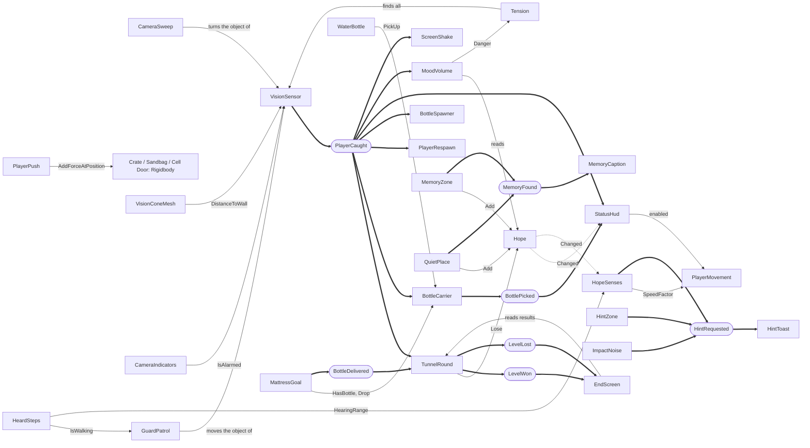

<div dir="rtl" lang="he">

# אור במנהרה: שלב הלימוד

השחקן מתעורר בתא במנהרה. הוא צריך לצאת, לעבור את השומר ואת מצלמות האבטחה בלי להיראות, לקחת בקבוק מים מהמחסן ולהחזיר אותו למזרן. הזיכרונות והתפילה נותנים תקווה, והתקווה נותנת לגוף כוח: מהירות, ראייה בחושך ושמיעה.

מסמך העיצוב: [Light-in-the-Tunnel](https://github.com/Game-development-Ariel/Light-in-the-Tunnel)

## קישורים

* המשחק באיץ': יתווסף אחרי ההעלאה
* דיווח על שימוש בבינה מלאכותית: [AI_REPORT.md](../AI_REPORT.md)

## איך מריצים

1. ב-Unity Hub פותחים את התיקייה `Light-in-the-Tunnel` (ולא את שורש המאגר), בגרסה 6000.3.25f1.
2. פותחים את הסצנה `Assets/Scenes/Tutorial` ולוחצים Play.

הסצנה נבנית מקוד, בכלים שב-`Assets/Scripts/Editor`. אחרי שינוי בכלים מריצים `Tools > Rebuild Scene`. בנייה לדפדפן: `Tools > Build WebGL`.

## איך משחקים

* תנועה: WASD או חצים. בטלפון יש ג'ויסטיק על המסך. M מציג ומסתיר את המפה.
* דוחפים דלת, ארגז או שק חול כשהולכים לתוכם.
* בפינה המוארת בקיר המסדרון עומדים שלוש שניות בלי לזוז, כדי לומר פסוק.
* **ניצחון**: מביאים את הבקבוק למזרן.
* **הפסד**: כל היתפסות (בפנס של השומר או באור של מצלמה) מורידה 20 תקווה ומחזירה לתא. בלי תקווה היום נגמר.

## פיסיקה

המשחק הזה לבדו משתמש בכל התכונות שנלמדו:

| תכונה | איפה | קובץ |
|---|---|---|
| CharacterController | תנועת השחקן. נעצר בקירות ומחליק לאורכם | [PlayerMovement.cs](Assets/Scripts/Player/PlayerMovement.cs) |
| Rigidbody | ארגזים, שקי חול ודלת התא | [TutorialMapBuilder.cs](Assets/Scripts/Editor/TutorialMapBuilder.cs) (הפונקציה `BuildLooseObjects`) |
| AddForce | השחקן דוחף בכוח שמופעל בנקודת המגע (`AddForceAtPosition`), ולכן ארגז גם מסתובב | [PlayerPush.cs](Assets/Scripts/Player/PlayerPush.cs) |
| Raycast | המצלמות והשומר: קרניים שנעצרות בקיר קובעות גם מה הם רואים וגם איך נראה קונוס האור. ארגז שנדחף עוצר אותן, אז אפשר להסתתר מאחוריו | [VisionSensor.cs](Assets/Scripts/Security/VisionSensor.cs) |
| Collision | ארגז שנדחף בודק במה פגע ובאיזו מהירות. מכה חזקה בקיר עושה רעש | [ImpactNoise.cs](Assets/Scripts/Level/ImpactNoise.cs) |
| מחבר (רשות) | דלת התא תלויה על HingeJoint ונפתחת כשנשענים עליה | [TutorialMapBuilder.cs](Assets/Scripts/Editor/TutorialMapBuilder.cs) (הפונקציה `CreateHingedDoor`) |

המנהרה מצוירת בדו-ממד, אבל הפיסיקה תלת-ממדית: לכל קיר שנוגע ברצפה יש BoxCollider, והכול זז על מישור X-Y. ההסבר בהחלטה 2 למטה.

## מבנה התיקיות

<div dir="ltr">

```
Assets/
├── Scripts/
│   ├── Player/     PlayerMovement, PlayerPush, PlayerRespawn, Hope, HopeSenses, HopeEffects, BottleCarrier
│   ├── Security/   VisionSensor, VisionStats, VisionConeMesh, CameraSweep, CameraIndicators, GuardPatrol, HeardSteps
│   ├── Items/      WaterBottle, BottleSpawner, MattressGoal
│   ├── Level/      HintZone, MemoryZone, QuietPlace, ImpactNoise
│   ├── Game/       TunnelRound, TunnelLevelSettings
│   ├── Events/     GameEvent, TextEvent   (ScriptableObject)
│   ├── UI/         StatusHud, HintToast, MemoryCaption, TitleCard, EndScreen, ObjectiveMarker, Minimap, ...
│   ├── Effects/    MoodVolume, Tension, ScreenShake, LightFlicker, ...
│   ├── Audio/      Footsteps, MusicPlayer, Sfx
│   ├── Camera/     CameraFollow, OrientationCameraSize
│   └── Editor/     the tools that build the scene
├── Data/           Events/, TutorialLevelSettings, HopeEffects, SecurityCameraVision, RoomCameraVision, GuardVision
├── Prefabs/  Scenes/  Sprites/  Tiles/  Resources/  Settings/
```

</div>

`Game` מחזיקה את החוקים (מתי מנצחים ומפסידים), ו-`UI` מציגה. קוד המשחק לא מכיר את קוד הממשק: הממשק מאזין לאירועים של המשחק, ולא להפך.

## יחסי המחלקות

יש שני סוגי אירועים:

* **אירוע כנכס** ([GameEvent](Assets/Scripts/Events/GameEvent.cs), [TextEvent](Assets/Scripts/Events/TextEvent.cs)): ScriptableObject שרכיב אחד מרים ואחרים מאזינים לו. השולח והמאזינים מחזיקים רק את הנכס ולא מכירים זה את זה.
* **אירוע רגיל של C#** (`event Action`): כשהמאזין ממילא מחזיק הפניה לשולח, כמו ה-HUD שמציג את התקווה.

כל הרשמה נעשית ב-`OnEnable` ומבוטלת ב-`OnDisable`.

בתרשים: מלבן הוא מחלקה, צורה מעוגלת היא אירוע כנכס (חץ עבה), חץ מקווקו הוא אירוע רגיל של C#, וחץ רגיל הוא קריאה ישירה.

<div dir="ltr">



</div>

| אירוע | מי שולח | מי מקבל |
|---|---|---|
| PlayerCaught | VisionSensor (של כל מצלמה ושל השומר) | TunnelRound (מוריד תקווה), BottleCarrier (מפיל את הבקבוק), PlayerRespawn (מחזיר לתא), BottleSpawner (בקבוק חדש), StatusHud, MoodVolume, ScreenShake |
| BottlePicked | BottleCarrier | StatusHud |
| BottleDelivered | MattressGoal | TunnelRound |
| LevelWon, LevelLost | TunnelRound | EndScreen |
| HintRequested | HintZone, ImpactNoise, HopeSenses | HintToast |
| MemoryFound | MemoryZone, QuietPlace | MemoryCaption |
| Hope.Changed | Hope | StatusHud, HopeSenses |

המצלמה בנויה מרכיבים קטנים על אותו אובייקט: CameraSweep מסובב, VisionSensor רואה, VisionConeMesh מצייר את מה שהחיישן רואה, ו-CameraIndicators מוסיף נורה וזמזום. השומר בנוי מאותם VisionSensor ו-VisionConeMesh, ורק מה שמזיז אותו שונה: GuardPatrol במקום CameraSweep.

התקווה משנה את הגוף דרך [HopeSenses](Assets/Scripts/Player/HopeSenses.cs): ככל שיש יותר תקווה הגיבור הולך מהר יותר, רואה רחוק יותר בחושך (רדיוס האור סביבו והבהירות של כל המנהרה) ושומע את צעדי השומר ממרחק גדול יותר, גם מאחורי קיר. המספרים בנכס [HopeEffects](Assets/Data/HopeEffects.asset).

## החלטות ארכיטקטורה

**1. אירועים כנכסים במקום GameManager.** במטלה 3 היה `GameManager` שהיה סינגלטון: המצלמה קראה ל-`GameManager.Instance.RegisterCapture()`, וה-HUD קרא ממנו את החיים בכל פריים. הוא החזיק את החיים, את הבקבוק, את מספר ההיתפסויות ואת מעבר הסצנות, וכל שינוי במשחק נגע בו. עכשיו המצלמה רק מרימה את `PlayerCaught`, וכל מי שצריך מגיב בעצמו. את GameManager פירקנו ל-Hope, BottleCarrier, PlayerRespawn ו-TunnelRound. החלופה הייתה להשאיר את הסינגלטון ולהוסיף לו אירועים, אבל אז עדיין כולם היו תלויים במחלקה אחת.

**2. CharacterController בלי לבנות את המנהרה מחדש בתלת-ממד.** המנהרה מצוירת בדו-ממד (Tilemap ותאורה דו-ממדית), ו-CharacterController הוא רכיב תלת-ממדי. החלופה הייתה לבנות את המנהרה מחדש מקוביות, אבל אז היינו מאבדים את התאורה והאווירה ממטלה 3. במקום זה השארנו את הציור כמו שהוא והחלפנו רק את הפיסיקה: לכל קיר שנוגע ברצפה יש BoxCollider תלת-ממדי, השחקן הוא CharacterController שהגובה שלו שווה לפעמיים הרדיוס (כלומר כדור) והוא זז על מישור X-Y, והמצלמות משתמשות ב-`Physics.Raycast`. השחקן נמצא בשכבה Ignore Raycast, כדי שהקרניים ייעצרו רק בקירות ובארגזים. על הקירות נשאר גם קוליידר דו-ממדי, רק כי הצללים של התאורה לוקחים ממנו את הצורה.

**3. מסך הסיום באותה סצנה.** במטלה 3 מסך הסיום היה סצנה נפרדת, ולכן ה-GameManager היה צריך לשרוד את המעבר (DontDestroyOnLoad) כדי להעביר את התוצאות. עכשיו EndScreen יושב בסצנת השלב, מאזין ל-`LevelWon` ו-`LevelLost` ומכסה את המסך. אין מידע שעובר בין סצנות, ולכן לא צריך אובייקט ששורד. "Play again" פשוט טוען את הסצנה מחדש.

כל המספרים לכוונון נמצאים בנכסים ב-`Assets/Data` (הגדרות השלב, השפעת התקווה, הראייה של כל סוג צופה) או בשדות Inspector.

## איך מוסיפים סוג אויב חדש

כך בדיוק הוספנו את השומר, אחרי שהמצלמה כבר עבדה:

1. סקריפט חדש אחד, [GuardPatrol.cs](Assets/Scripts/Security/GuardPatrol.cs), שמוליך אותו בין נקודות.
2. על אותו אובייקט שמנו את VisionSensor ו-VisionConeMesh הקיימים, עם נכס VisionStats חדש ([GuardVision](Assets/Data/GuardVision.asset): ראייה רחבה וקצרה יותר).
3. הוספנו אותו למפה ב-[TutorialMapBuilder.cs](Assets/Scripts/Editor/TutorialMapBuilder.cs).

שום קובץ אחר לא השתנה, כי השומר מרים את אותו `PlayerCaught`, וכל מה שקורה כשנתפסים (תקווה, חזרה לתא, בקבוק, מסך, צליל) כבר מאזין לו. גם Tension, שמגביר את הדופק ליד סכנה, מחפש כל VisionSensor ולא "מצלמה". המצלמה השנייה במחסן היא אפילו פחות מזה: רק נכס VisionStats נוסף ותו במפה. אויב מסוג אחר לגמרי, למשל כלב ששומע במקום לראות, יצטרך סקריפט חיישן משלו שמרים את אותו אירוע.

**חפץ חדש**, למשל זיכרון נוסף: עוד שורה ב-[GameFeelSetup.cs](Assets/Scripts/Editor/GameFeelSetup.cs) שמוסיפה MemoryZone עם טקסט וכמות תקווה. בלי קוד חדש.

## סינגלטון ומשתנים סטטיים

אין סינגלטון. ה-GameManager ממטלה 3 נמחק, וגם `Tension.Danger` ו-`ScreenShake.Shake` שהיו סטטיים הפכו לרכיבים רגילים.

| איפה | מה | למה |
|---|---|---|
| [Sfx](Assets/Scripts/Audio/Sfx.cs) | מחלקה סטטית עם AudioSource אחד | צליל קצר צריך להמשיך גם כשהסצנה נטענת מחדש (הקליק של Play again), אז המקור שלו לא יכול להיות שייך לסצנה. אין בו מצב של המשחק |
| [ScreenFader](Assets/Scripts/UI/ScreenFader.cs) | `FadeAndLoad` סטטית ודגל `isFading` | המסך השחור חייב לשרוד את טעינת הסצנה כדי להתבהר אחריה. הדגל מונע טעינה כפולה |
| UiFactory, UiAnim, UiTheme | מחלקות סטטיות של פונקציות עזר וקבועים | אין בהן מצב, רק פונקציות שמקבלות קלט ומחזירות פלט |
| `MobileJoystick.UsesTouch` | תכונה סטטית | שאלה על המכשיר ולא על אובייקט מסוים |

## מה השתנה לעומת מסמך העיצוב

* בשלב הלימוד אפשר עכשיו להפסיד (התקווה יורדת עד 0), כדי שתנאי ההפסד יעבוד.
* נוספו שומר שמסייר במסדרון הראשון (מתחבאים ממנו בגומחות שבקיר), מצלמה שנייה במחסן, מקום שקט לתפילה וזיכרון שלישי.
* מתחילים עם 30 תקווה, וכל תקווה שמשיגים מורגשת מיד: המהירות עולה (מ-1.8 עד 3.2 משבצות בשנייה), האור סביב הגיבור גדל, המנהרה כולה מתבהרת, ויש הבזק אור ברגע הקבלה.
* דלת התא נפתחת על ציר, ויש ארגזים ושקי חול לדחוף, כהכנה לחפירה בשקי החול שבמסמך השלבים.

</div>
